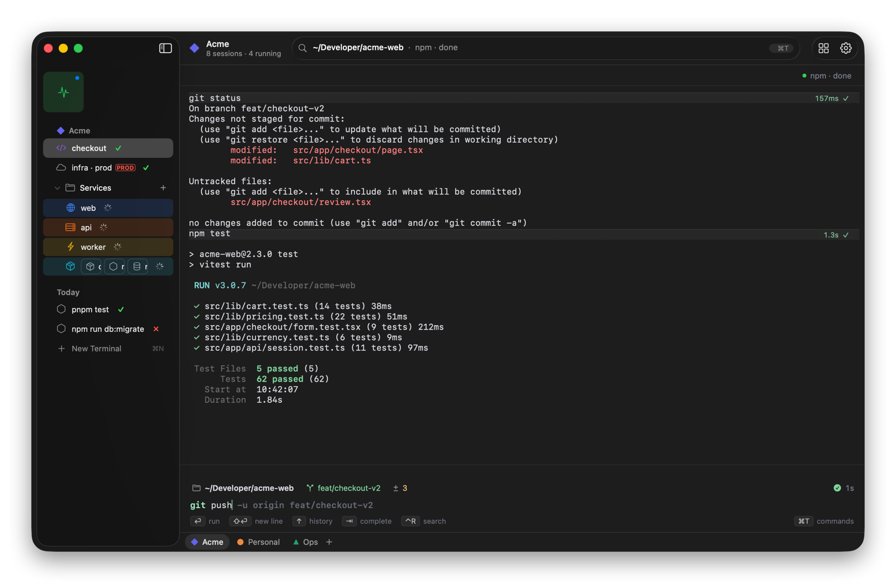

# Termorc

A macOS terminal where every session lives in a vertical sidebar, grouped into colored **Spaces**.

<picture>
  <source media="(prefers-color-scheme: dark)" srcset="docs/screenshots/main-dark.png">
  <source media="(prefers-color-scheme: light)" srcset="docs/screenshots/main-light.png">
  
</picture>

**[See every screen and feature →](docs/FEATURES.md)**

## What it does

- **Spaces.** Each Space has its own color, pinned sessions, folders, start directory and shell profile. Switch with ⌃1–9, ⌃←/→, a two-finger swipe on the sidebar, or the All Spaces overview (⌃↑ or pinch).
- **Sidebar.** It has four parts:
  - Favorites: always-on sessions shared by every Space.
  - Pinned: named sessions in collapsible folders.
  - Today: temporary sessions.
  - Icon & Color… (right-click a row) gives a session its own icon and a tinted row.
  - Live status on every row: running, idle, ✓ done, ✗ failed (hover for the exit code, click to jump to the error), and a bell badge.
- **Status line.** The bar along the bottom lists the Spaces (a dot marks unseen finished jobs; drop a session on one to move it there). The title bar shows the focused session's directory and process; click it for the command bar.
- **Command bar (⌘T).** One fuzzy search over open sessions, recent directories, SSH hosts (`~/.ssh/config`), snippets and actions. Prefixes: `>` runs a command, `@` searches hosts, `/` searches snippets. ⇥ cycles filters.
- **Splits.** ⌘D / ⇧⌘D, up to four panes per card. You can also drag a sidebar row onto a card edge. Dividers snap to ⅓, ½ and ⅔. Drag a pane header back to the sidebar to unsplit it.
- **Peek.** Hover a row for 400 ms to see its last lines streaming live. ⇧-click keeps the peek open.
- **Auto-archive and Library (⌘Y).** Idle Today sessions move to the Library after 12 h (configurable, with Undo). Library search covers names, commands, output and paths. Restore brings back the scrollback.
- **Danger sessions.** Right-click a row to give it a red danger frame; on those, `sudo`, restarts and `rm -rf` ask before running. The same menu can keep a session from auto-archiving.
- **Input bar and blocks.** Type commands in Termorc's own input bar: syntax colors, a suggestion from history (→ accepts), ↑/↓ recall, ⌃R search, ⇥ completion for commands, paths and git branches. Each command's output is a block with its time, duration and exit status. Settings → Terminal → Prompt → Shell brings back your shell's own prompt.
- **Finder.** Right-click a folder › Services › **New Termorc Tab Here**, or drop a folder on the Dock icon.
- **Quick Terminal (⌥Space).** A global drop-down panel. It opens in the frontmost Finder folder. "Move to Space" promotes it to a sidebar row with its scrollback intact.
- **Extras:**
  - ⇧⌘C copies only the last command's output.
  - A "Jump to bottom" pill appears when you scroll up.
  - Dropped SSH connections show a reconnect sheet.
  - Long jobs in other Spaces notify you.
  - Focus mode: ⌘S hides the sidebar, and hovering the left edge reveals it.

## How it works

Termorc is a native macOS app in AppKit and SwiftUI, built with Swift Package Manager. Terminals are [SwiftTerm](https://github.com/migueldeicaza/SwiftTerm) views.

| Path | Notes |
| --- | --- |
| `Sources/TermorcCore/` | Model, persistence, settings.json, Library, shell launch, command-line helpers. No AppKit, unit-tested. |
| `Sources/Termorc/` | The app: window, sidebar, cards and panes, command bar, Settings, Library, Quick Terminal, input bar. |
| `Resources/shell-integration/` | Hooks for zsh, bash and fish. They emit OSC 633 marks (prompt, command, exit code, cwd) and still load your own dotfiles. The app reads the marks from the PTY stream; they drive the status marks, names, command blocks, notifications, ⇧⌘C and the Library. |
| `Resources/` | Also `Info.plist` (the version lives here), the app icons and the installer background. |
| `tests/TermorcCoreTests/` | Unit tests for TermorcCore. |

State lives in `~/Library/Application Support/Termorc/`:
- `state.json`
- `scrollback/` for live sessions across restarts
- `library/` for archived sessions

Settings live in `~/.termorc/settings.json`.

## Develop

Needs Xcode (or its command-line tools) for Swift 6.

```bash
swift test                          # unit tests
scripts/build-app.sh                # debug build → .build/Termorc.app
scripts/build-app.sh release        # release build → .build/release-app/Termorc.app
scripts/build-app.sh debug run      # build, then open it
scripts/make-dmg.sh                 # release build plus a styled .dmg (needs dmgbuild: pip3 install dmgbuild)
```

Set `TERMORC_DATA_DIR=/some/folder` to run a build with its own state and settings, apart from your everyday sessions: `TERMORC_DATA_DIR=/tmp/termorc-dev scripts/build-app.sh debug run`.

The installer window's background is `Resources/dmg/background.svg`, rendered to `background.tiff` (1× and 2×); the layout lives in `scripts/dmg-settings.py`.

The icon's artwork is `Resources/icons/icon-art.png` (the `>_` on a transparent background). On macOS 26 and later the Dock uses `Resources/icons/AppIcon.icon`, an Icon Composer document with light, dark, clear and tinted looks; open it in Icon Composer (bundled with Xcode) to edit. Compiling it needs Xcode 26's `actool`, so point the command-line tools at Xcode once with `sudo xcode-select -s /Applications/Xcode.app`; otherwise the build skips it and every macOS version falls back to `icon.icns`. That fallback comes from `Resources/icons/icon.svg`: after editing it, render the sizes into an `.iconset` folder and run `iconutil -c icns`.
