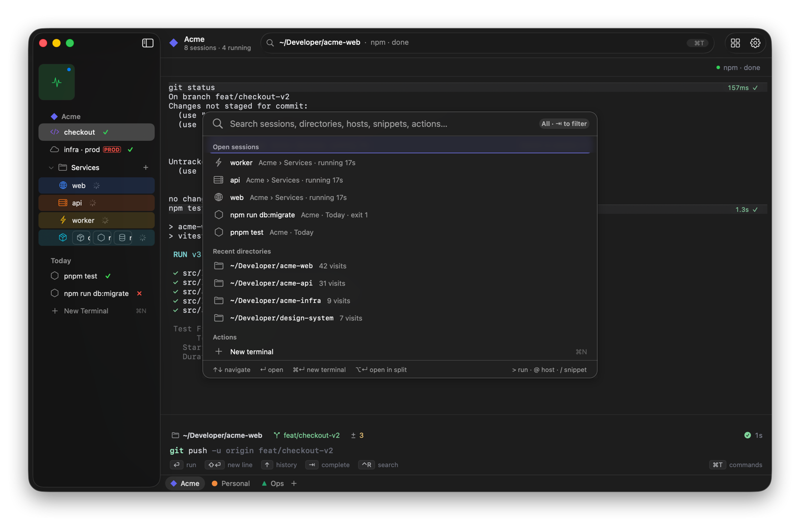
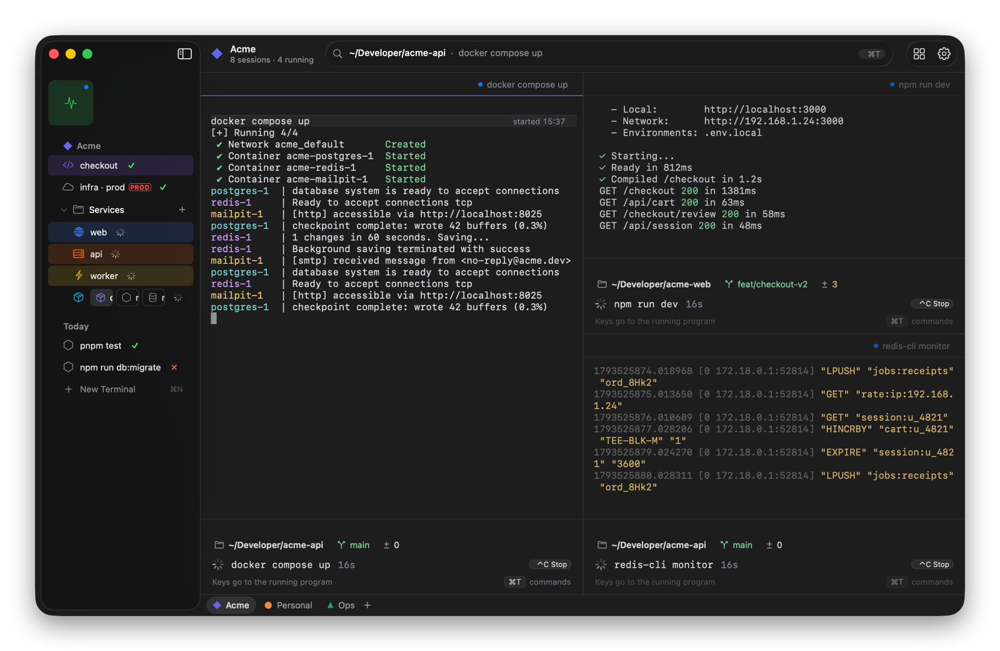
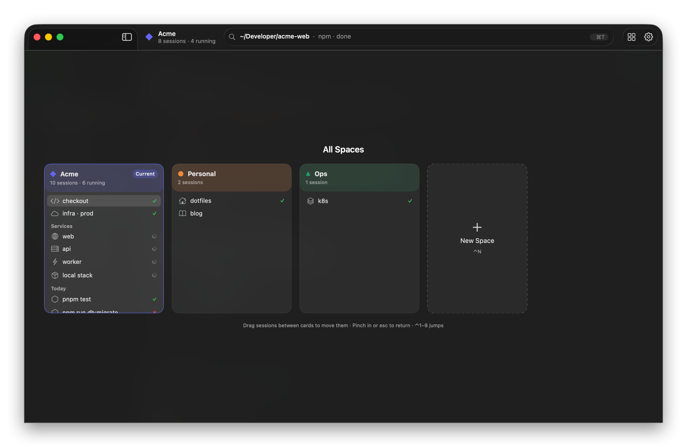
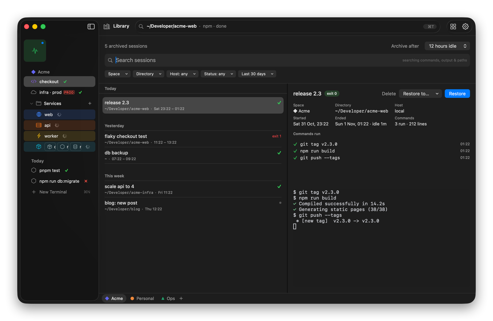
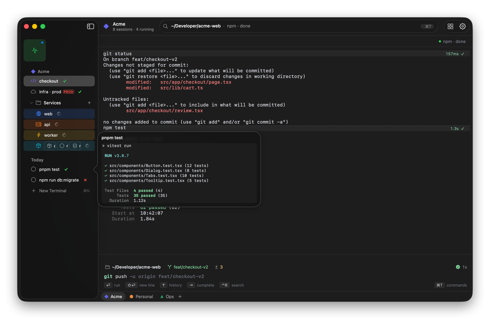
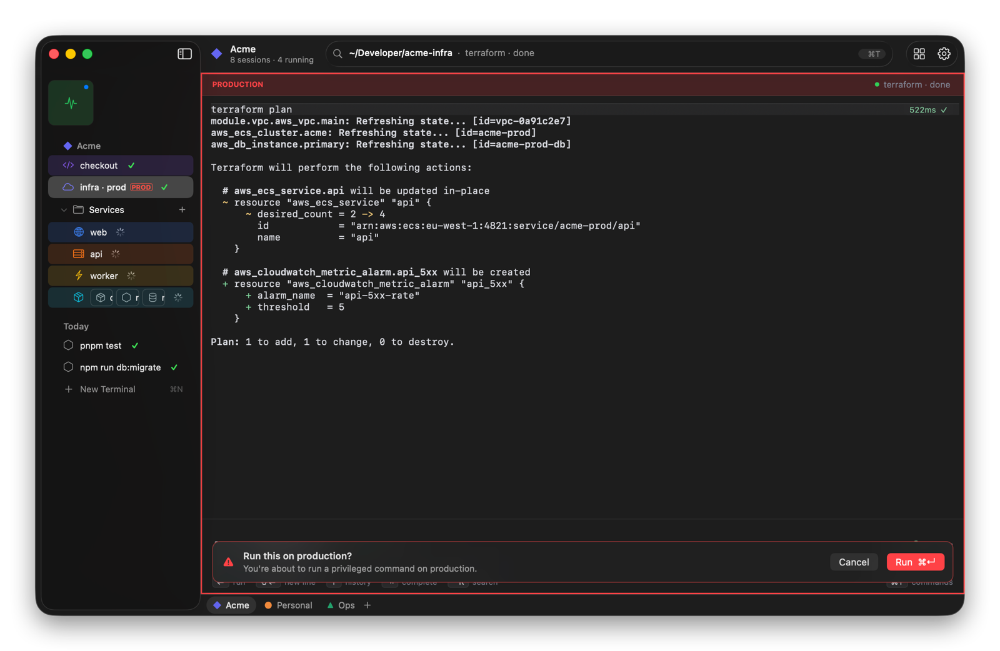

<p align="center">
  
</p>

<h1 align="center">Termorc</h1>

<p align="center">
  <strong>A native macOS terminal where every session lives in a sidebar, grouped into colored Spaces.</strong>
</p>

<p align="center">
  
  
  
  
</p>

<p align="center">
  <a href="https://github.com/nazmulnahid-git/Termac/releases/latest"><b>Download</b></a> ·
  <a href="docs/FEATURES.md"><b>Tour</b></a> ·
  <a href="#features">Features</a> ·
  <a href="#install">Install</a> ·
  <a href="#keyboard-shortcuts">Shortcuts</a> ·
  <a href="#develop">Develop</a>
</p>

<picture>
  <source media="(prefers-color-scheme: dark)" srcset="docs/screenshots/main-dark.png">
  <source media="(prefers-color-scheme: light)" srcset="docs/screenshots/main-light.png">
  
</picture>

## Why Termorc

If you keep a dozen terminal tabs open across a few projects, Termorc gives them a home.

- **One Space per project.** Each has its own color, icon, sessions and start directory. Flip between them with ⌃1–9 or a swipe.
- **See what's happening at a glance.** Every session in the sidebar shows whether it's running, finished ✓ or failed ✗, without switching to it. Hover a row to peek at its output.
- **Commands become blocks.** Each command's output gets a header with how long it took and whether it passed. Type in an input bar with syntax colors, history suggestions and completion.
- **Nothing gets lost.** Idle sessions archive themselves into a searchable Library, scrollback included, and come back with one click.

## A look around

<table>
  <tr>
    <td width="50%"><a href="docs/FEATURES.md#command-bar"></a><p align="center"><b>Command bar</b>: one fuzzy search over sessions, folders, SSH hosts and snippets</p></td>
    <td width="50%"><a href="docs/FEATURES.md#splits"></a><p align="center"><b>Splits</b>: up to four panes, each with its own input bar</p></td>
  </tr>
  <tr>
    <td width="50%"><a href="docs/FEATURES.md#all-spaces"></a><p align="center"><b>All Spaces</b>: every project and its sessions on one screen</p></td>
    <td width="50%"><a href="docs/FEATURES.md#library"></a><p align="center"><b>Library</b>: archived sessions you can search and restore</p></td>
  </tr>
  <tr>
    <td width="50%"><a href="docs/FEATURES.md#peek"></a><p align="center"><b>Peek</b>: hover a row to watch its output live</p></td>
    <td width="50%"><a href="docs/FEATURES.md#danger-sessions"></a><p align="center"><b>Danger sessions</b>: production sessions ask before risky commands</p></td>
  </tr>
</table>

<p align="center"><a href="docs/FEATURES.md"><b>Take the full tour, with every screen →</b></a></p>

## Features

**Spaces and the sidebar**
- Spaces with their own color, icon, pinned sessions, folders, start directory and shell profile. Switch with ⌃1–9, ⌃⌥← / ⌃⌥→, a two-finger swipe, or the All Spaces overview (⌃⌥↑ or pinch).
- Favorites (shared by every Space), Pinned sessions in collapsible folders, and Today for throwaway sessions.
- Live status on every row: running, idle, ✓ done, ✗ failed (hover for the exit code, click to jump to the error), and a bell badge.
- Right-click a row and choose **Icon & Color…** to give it its own icon and a tinted row.
- A compact icon-rail mode, and ⌘S to hide the sidebar completely (move the pointer to the left edge to bring it back).

**Typing and output**
- Termorc's own input bar: syntax colors, history suggestions (→ accepts), ↑ / ↓ recall, ⌃R search, and ⇥ completion for commands, paths and git branches.
- Command blocks with duration and exit status; ⇧⌘C copies just the last command's output.
- Chips for the directory, git branch and changes; click one to change directory or switch branch.
- Prefer your shell's own prompt? **Settings › Terminal › Prompt › Shell**.

**Getting around**
- **Command bar (⌘T):** one fuzzy search over everything. `>` runs a command, `@` searches SSH hosts, `/` searches snippets.
- **Splits:** ⌘D and ⇧⌘D, up to four panes. Drag a sidebar row onto a pane edge to split, and drag a pane header back to unsplit. Dividers snap to ⅓, ½ and ⅔.
- **Quick Terminal (⌥Space):** a drop-down terminal from any app. It opens in the frontmost Finder folder, and **Move to Space** keeps it.
- **Finder:** right-click a folder › Services › **New Termorc Tab Here**, or drop a folder on the Dock icon.

**Staying safe and tidy**
- **Danger sessions:** a red frame on production sessions; `sudo`, restarts and `rm -rf` ask before they run.
- **Auto-archive and Library (⌘Y):** idle Today sessions move to the Library after 12 hours (configurable, with Undo). Search covers names, commands, output and paths.
- Sessions and scrollback come back after a restart, dropped SSH connections offer to reconnect, and long jobs in other Spaces send a notification when they finish.

## Install

**Download:** get **Termorc_2.0.1_arm64.dmg** from the [latest release](https://github.com/nazmulnahid-git/Termac/releases/latest). It needs macOS 14 or later on Apple Silicon.

1. Open the `.dmg` and drag **Termorc** into **Applications**.
2. Run this once in Terminal:

   ```bash
   xattr -cr /Applications/Termorc.app
   ```

   Termorc isn't signed with an Apple Developer ID yet, so without this step macOS refuses to open it, saying it's damaged or can't be opened.
3. Open Termorc from Applications. It starts with a **Home** Space; ⇧⌘N creates more.

**Build from source** instead (needs Xcode 16+ or its command-line tools):

```bash
git clone https://github.com/nazmulnahid-git/Termac.git
cd Termac
scripts/build-app.sh release
cp -R .build/release-app/Termorc.app /Applications/
```

For the macOS 26 Dock icon (light, dark, clear and tinted looks), point the command-line tools at Xcode once: `sudo xcode-select -s /Applications/Xcode.app`. Without that, the app uses its standard icon.

## Keyboard shortcuts

| | |
| --- | --- |
| **⌘T** command bar | **⌘N** new terminal |
| **⌘D / ⇧⌘D** split right / down | **⌘W** close pane |
| **⌃1–9** go to Space | **⌘1–9** go to session |
| **⌃⌥↑** All Spaces | **⌘Y** Library |
| **⌥Space** Quick Terminal | **⌘S** show / hide sidebar |
| **⇧⌘C** copy last output | **⌘,** Settings |

Every shortcut can be changed in **Settings › Keybindings**. [Full list →](docs/FEATURES.md#keyboard-shortcuts)

## Your data

| What | Where |
| --- | --- |
| Settings | `~/.termorc/settings.json` (edit it, or use Settings; a JSON Schema sits beside it for autocompletion) |
| Spaces and sessions | `~/Library/Application Support/Termorc/state.json` |
| Scrollback | `~/Library/Application Support/Termorc/scrollback/` |
| Library | `~/Library/Application Support/Termorc/library/` |

## How it works

Termorc is a native AppKit and SwiftUI app built with Swift Package Manager. Terminals are [SwiftTerm](https://github.com/migueldeicaza/SwiftTerm) views.

The shell integration for zsh, bash and fish emits OSC 633 marks for the prompt, each command, its exit code and the working directory, and still loads your own dotfiles. Termorc reads those marks from the PTY stream. They drive the row statuses, session names, command blocks, notifications, ⇧⌘C and the Library.

| Path | What's there |
| --- | --- |
| `Sources/TermorcCore/` | Model, persistence, settings.json, Library, shell launch and command-line helpers. No AppKit, unit-tested. |
| `Sources/Termorc/` | The app: window, sidebar, panes, input bar, command bar, Settings, Library and Quick Terminal. |
| `Resources/` | `Info.plist` (the version lives here), shell integration, app icons and the installer background. |
| `tests/TermorcCoreTests/` | Unit tests for TermorcCore. |
| `docs/` | The feature tour and its screenshots. |

## Develop

```bash
swift test                          # unit tests
scripts/build-app.sh                # debug build   → .build/Termorc.app
scripts/build-app.sh release        # release build → .build/release-app/Termorc.app
scripts/build-app.sh debug run      # build, then open it
scripts/make-dmg.sh                 # release build plus a styled .dmg (pip3 install dmgbuild)
```

**Run a build on its own data.** Set `TERMORC_DATA_DIR` so a development build doesn't touch your everyday sessions and settings:

```bash
TERMORC_DATA_DIR=/tmp/termorc-dev scripts/build-app.sh debug run
```

**Icons and installer:**
- **Artwork:** the `>_` mark is `Resources/icons/icon-art.png`.
- **macOS 26 and later:** the Dock uses `Resources/icons/AppIcon.icon`, an Icon Composer document (Icon Composer comes with Xcode). Compiling it needs Xcode 26's `actool`. Without it, every macOS version falls back to `icon.icns`.
- **Older macOS:** `icon.icns` is generated from `Resources/icons/icon.svg`. After editing the SVG, render the sizes into an `.iconset` folder and run `iconutil -c icns`.
- **Installer window:** the background is `Resources/dmg/background.svg`, rendered to `background.tiff` (1× and 2×). The layout is in `scripts/dmg-settings.py`.
