# Termorc

**A native macOS terminal where every session lives in a sidebar, grouped into colored Spaces.**

<picture>
  <source media="(prefers-color-scheme: dark)" srcset="screenshots/main-dark.png">
  <source media="(prefers-color-scheme: light)" srcset="screenshots/main-light.png">
  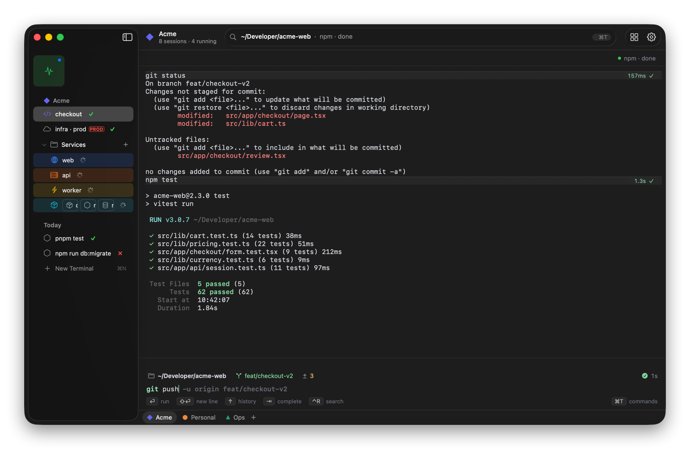
</picture>

Built in Swift with AppKit and SwiftUI. Light and dark follow the system, and every screen below is the real app.

**Contents:**
[Spaces and the sidebar](#spaces-and-the-sidebar) ·
[Input bar and command blocks](#input-bar-and-command-blocks) ·
[Splits](#splits) ·
[Command bar](#command-bar) ·
[All Spaces](#all-spaces) ·
[Peek](#peek) ·
[Danger sessions](#danger-sessions) ·
[Library](#library) ·
[Quick Terminal](#quick-terminal) ·
[Compact sidebar](#compact-sidebar) ·
[Space settings](#space-settings) ·
[Settings](#settings) ·
[Shortcuts](#keyboard-shortcuts)

---

## Spaces and the sidebar

Each project gets a **Space** with its own color, icon, start directory and shell profile. The bar along the bottom lists your Spaces; switch with ⌃1–9, ⌃← / ⌃→, or a two-finger swipe on the sidebar.

The sidebar has three parts:

| Part | What it holds |
| --- | --- |
| **Favorites** | Always-on sessions shared by every Space, shown as tiles at the top (here, `prod logs`). |
| **Pinned** | Named sessions you keep, optionally in collapsible folders (here, `Services`). |
| **Today** | Throwaway sessions. Idle ones move to the Library after 12 hours. |

Every row shows its status live:
- **Running:** a spinner.
- **Finished:** ✓ for success, ✗ for failure. Hover the ✗ for the exit code, or click it to jump to the error.
- **Bell:** a badge when the session rings.

Right-click a row and choose **Icon & Color…** to give it its own icon and a tinted background, like `web`, `api` and `worker` above.

## Input bar and command blocks

You type commands in Termorc's own input bar instead of at a raw prompt:

- **Syntax colors** as you type.
- **History suggestions:** a grey suggestion follows the cursor; → accepts it. In the screenshot above, `git push` already suggests `-u origin feat/checkout-v2`.
- **Recall and search:** ↑ / ↓ go through earlier commands, ⌃R searches them.
- **Completion:** ⇥ completes commands, paths and git branches.
- **Status chips** above the input show the directory, the git branch and how many files changed. Click one to change directory or switch branch.

Each command's output becomes a **block**: its header shows how long it took and whether it passed (`157ms ✓`, `1.3s ✓`). ⇧⌘C copies the last command's output only.

Prefer your shell's own prompt? **Settings › Terminal › Prompt › Shell**.

## Splits

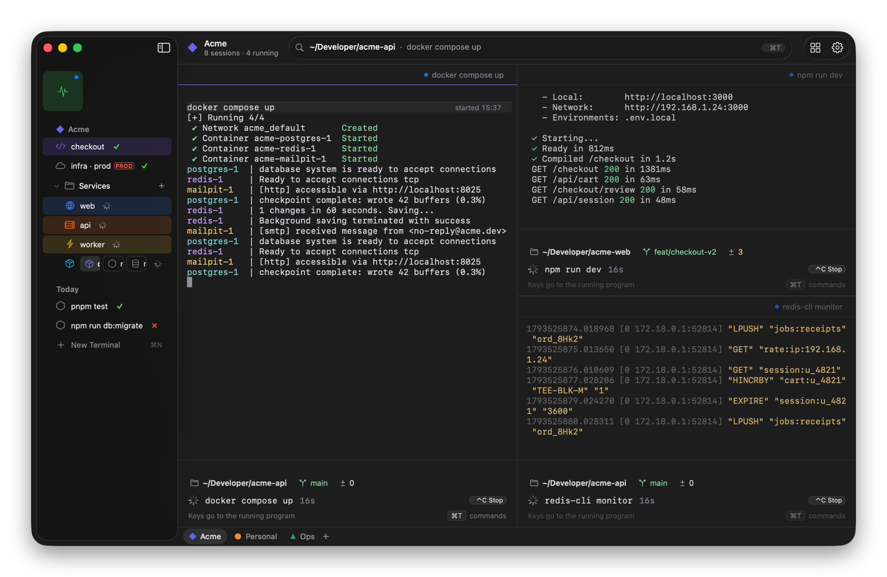

Split any session up to four panes: ⌘D splits right, ⇧⌘D splits down. You can also drag a sidebar row onto the edge of a pane. Dividers snap to ⅓, ½ and ⅔, and ⌥⌘ plus an arrow key moves focus between panes. To unsplit, drag a pane's header back to the sidebar.

While a program runs, the input bar becomes a status line with the command, how long it has been running and a ⌃C Stop button.

In light mode

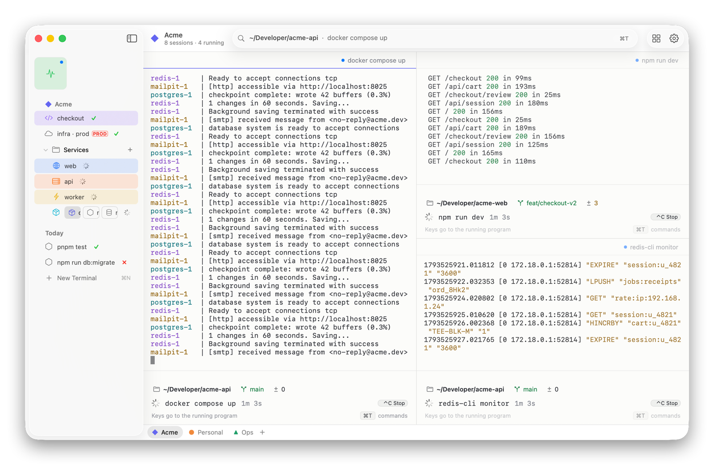

## Command bar

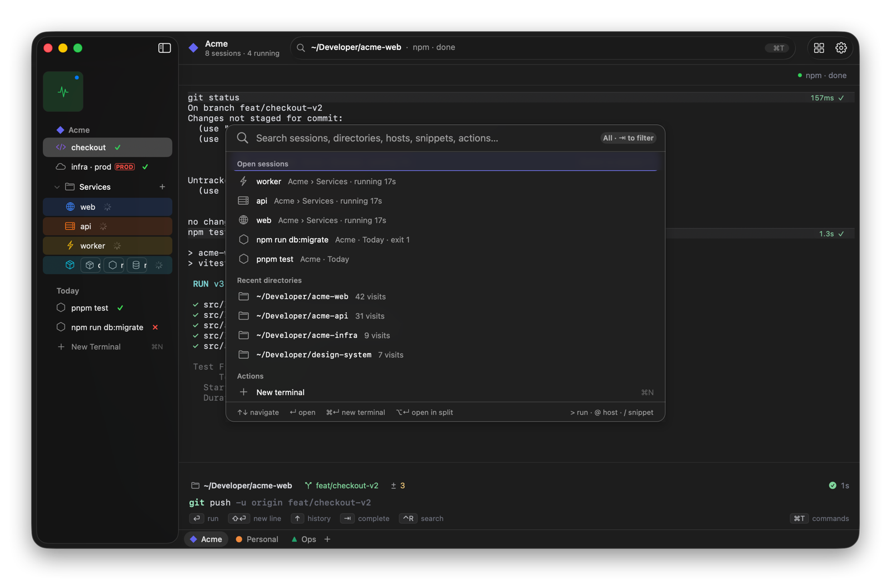

**⌘T** opens one fuzzy search over everything:
- open sessions
- recent directories
- SSH hosts from `~/.ssh/config`
- snippets
- actions

Click the path in the toolbar to open it too.

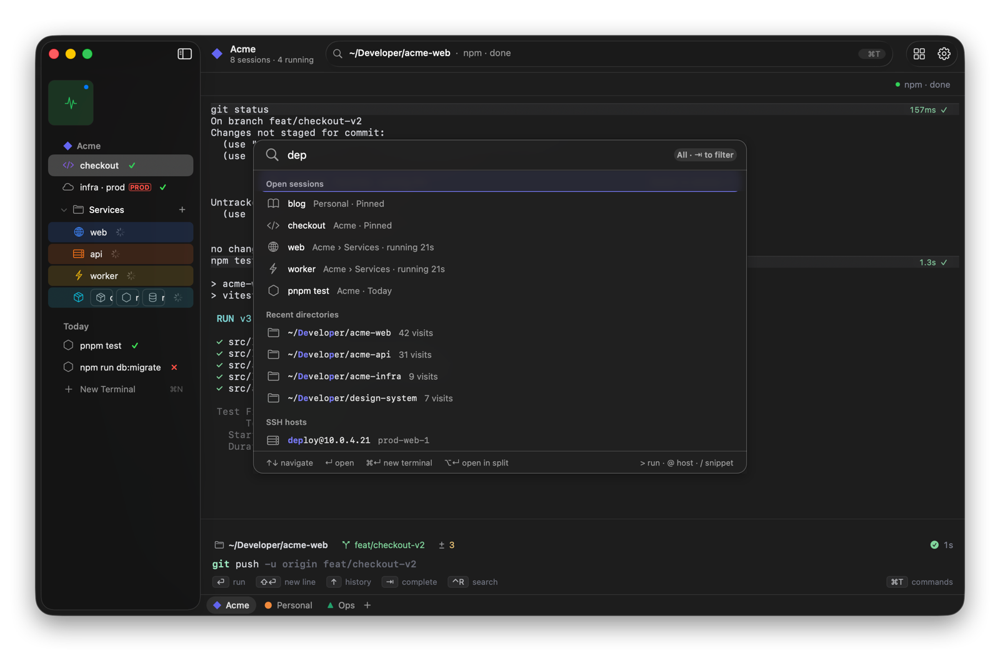

Prefixes narrow it down, and ⇥ cycles through the filters:

| Prefix | Does |
| --- | --- |
| `>` | Runs the command in a new terminal |
| `@` | Searches SSH hosts |
| `/` | Searches snippets |

## All Spaces

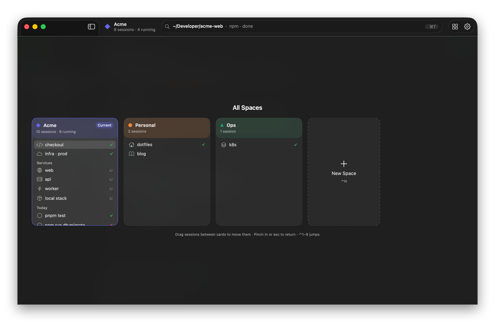

**⌃↑**, or a pinch on the trackpad, shows every Space as a card with its sessions and their status. Drag a session from one card to another to move it. ⌃1–9 jumps straight to a Space, and Esc (or pinching out) returns.

## Peek

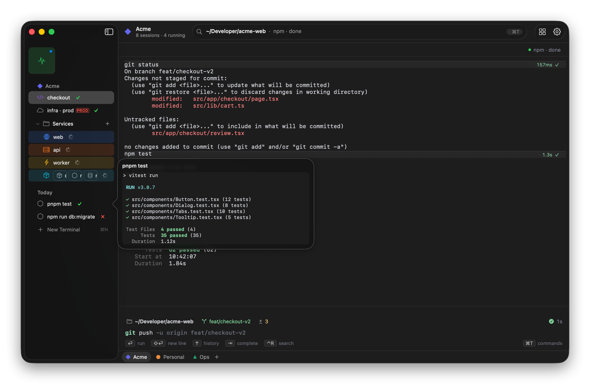

Hover a sidebar row for 400 ms to see its latest output, streaming live, without switching to it. ⇧-click keeps the peek open.

## Danger sessions

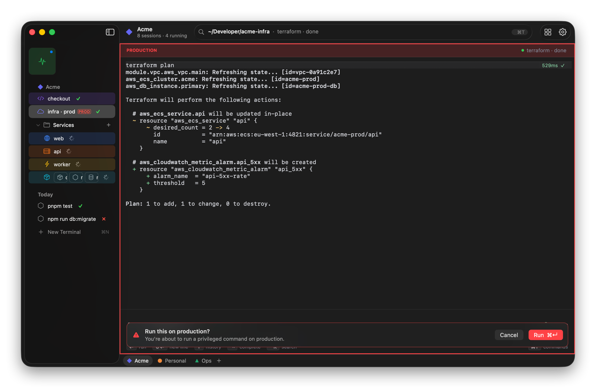

Right-click a row and mark it as **danger**. It gets a red frame, a `PRODUCTION` banner and a `PROD` badge in the sidebar. On these sessions, `sudo`, service restarts and `rm -rf` ask before they run (⌘↩ confirms). The same menu can keep a session from being auto-archived.

## Library

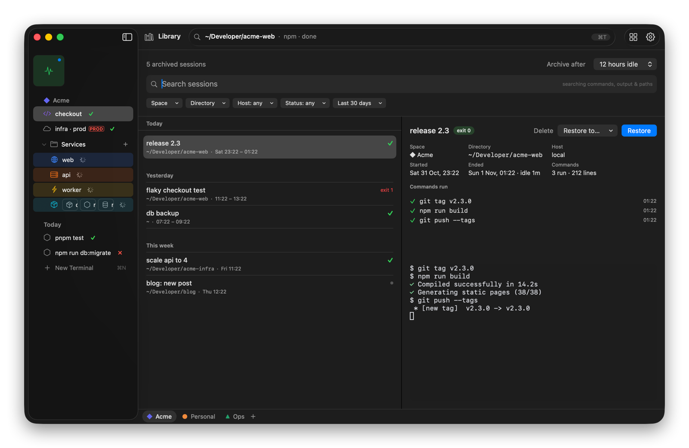

**⌘Y** opens every archived session:
- **Archiving:** idle Today sessions move here automatically, with Undo, after the time you set (12 hours by default).
- **Search:** it covers names, commands, output and paths, and you can filter by Space, directory, host, status and date.
- **Restore:** brings a session back to the sidebar with its scrollback.

## Quick Terminal

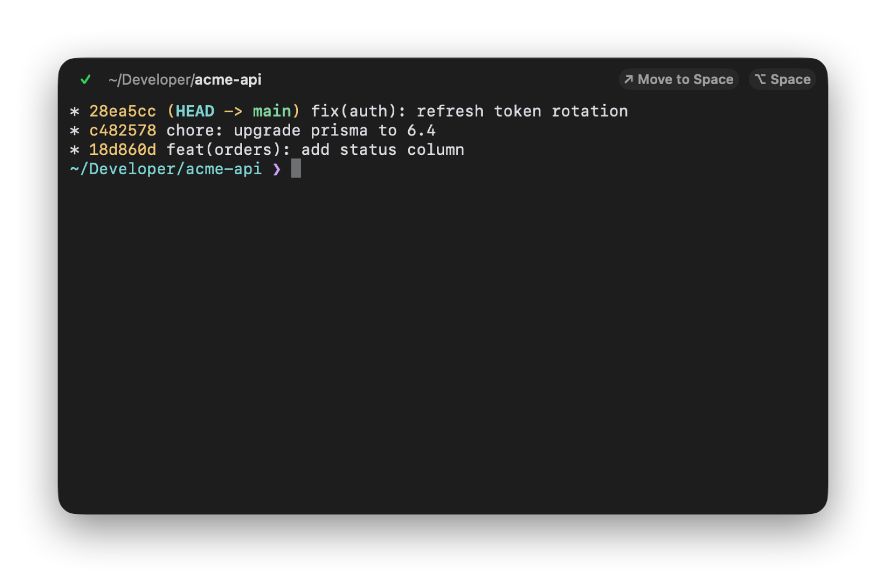

**⌥Space** drops down a terminal from anywhere, even when Termorc isn't in front. It opens in the frontmost Finder folder. **Move to Space** turns it into a sidebar row, scrollback included.

## Compact sidebar

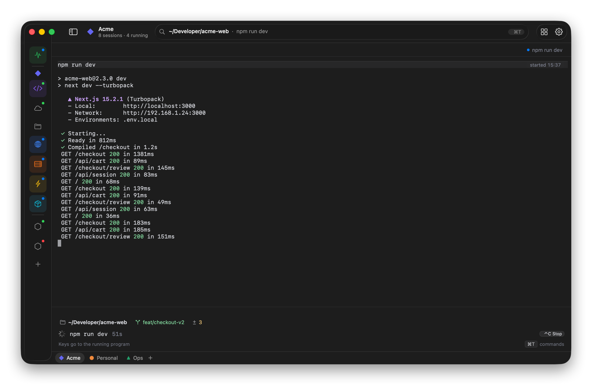

When you need the width, switch the sidebar to **Compact**: an icon rail that keeps each session's icon, color and status dot. **⌘S** hides the sidebar completely. While it's hidden, move the pointer to the window's left edge and it slides back in.

## Space settings

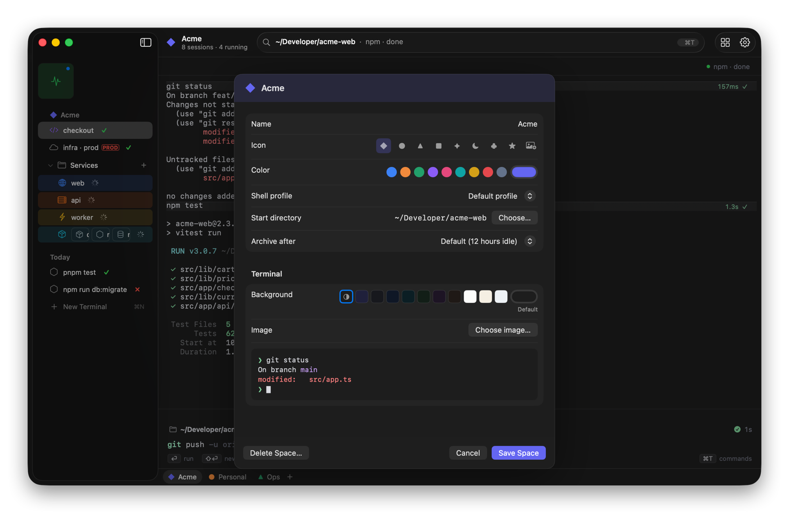

Each Space has its own:
- name, icon (a glyph or your own image) and color
- shell profile and start directory
- archive time
- terminal background (a color or an image), with a live preview

## Settings

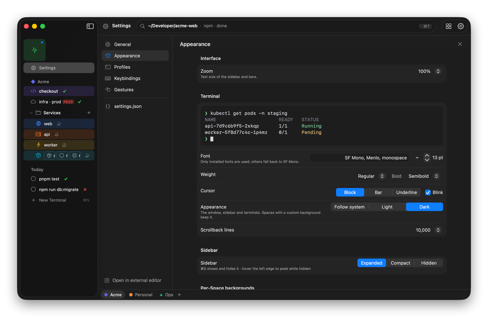

Settings opens in place of the terminal (**⌘,**), with a live preview while you change fonts, cursor and theme. Everything is also in `~/.termorc/settings.json`, with a JSON Schema for autocompletion in your editor. Changes made in the file apply straight away.

## Keyboard shortcuts

All of these can be changed in **Settings › Keybindings**.

| Shortcut | Action |
| --- | --- |
| ⌘T | Command bar |
| ⌘N | New terminal in the current directory |
| ⌥Space | Quick Terminal (works from any app) |
| ⌘S | Show / hide the sidebar |
| ⌘D / ⇧⌘D | Split right / split down |
| ⌘W | Close pane |
| ⌥⌘ ← → ↑ ↓ | Move focus between panes |
| ⇧⌘[ / ⇧⌘] | Previous / next session |
| ⌘1–9 | Go to session 1–9 |
| ⌃← / ⌃→ | Previous / next Space |
| ⌃1–9 | Go to Space 1–9 |
| ⌃↑ | All Spaces |
| ⌃N | New Space |
| ⌘Y | Library |
| ⇧⌘C | Copy the last command's output |
| ⌘K | Clear scrollback |
| ⌘F | Find in terminal |
| ⌘↓ | Jump to bottom |
| ⌘R | Reconnect a dropped SSH session |
| ⌘= / ⌘- / ⌘0 | Bigger / smaller / actual-size text |
| ⌘, | Settings |

---

The screenshots were taken from the real app, running on made-up demo projects.
